# SignALL: manual de identidad visual

Versión 1.1 · 16 de octubre de 2026 · Proyecto de tesis, Pontificia Universidad Javeriana.
Es la referencia para la app Android y para cualquier pieza que la acompañe.

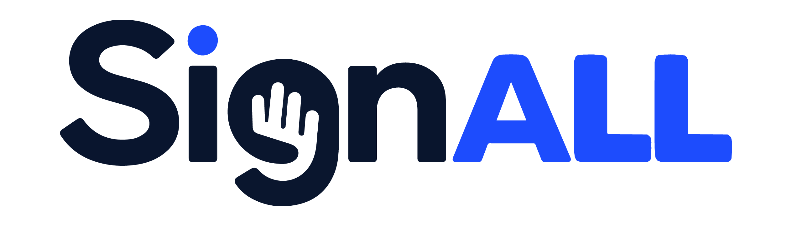

## 1. Qué cambió en esta versión

La app se veía demasiado azul porque el fondo, las superficies y los bordes eran todos navy. Ahora el azul de marca queda solo en la acción principal y los controles; el resto es grafito neutro, y un ámbar marca cuando la app está escuchando.

| Elemento | Antes | Ahora |
|---|---|---|
| Fondo | `#0C142C` navy | `#121316` grafito |
| Superficies y bordes | Navy `#141D3A` / `#263463` | Grafito `#1A1B1F` / `#33363D` |
| Mic y TR encendidos | Azul | Ámbar `#F2B84B` |
| Traducir, interruptores, slider | Azul `#1C4CFC` | Sin cambio |
| Acento en modo claro | Negro `#171717` | Azul `#1C4CFC` |

## Antes y después (modo oscuro)

Izquierda, la app con el fondo navy anterior (Redmi Note 9S). Derecha, la app compilada con la paleta grafito, capturada en el emulador de Android Studio: la barra de estado y la proporción de pantalla cambian por el dispositivo, no por el diseño. El ámbar de micrófono y TR todavía no tiene captura: aparece con el micrófono encendido y hace falta el servidor de traducción corriendo.

| Antes | Después |
|---|---|
| 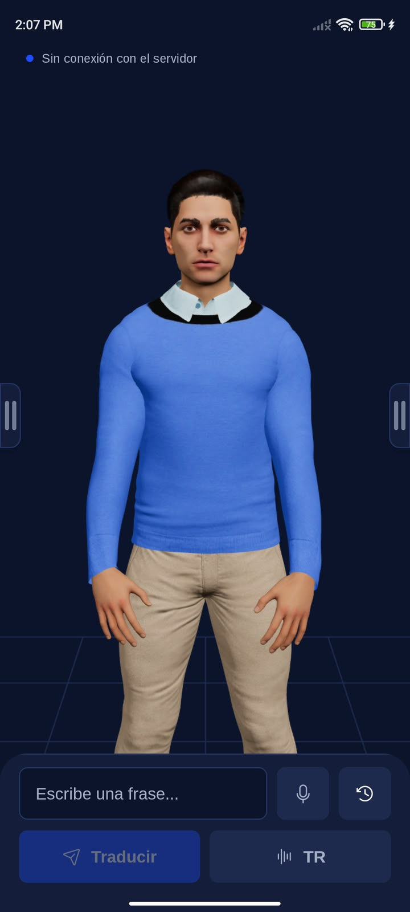 | 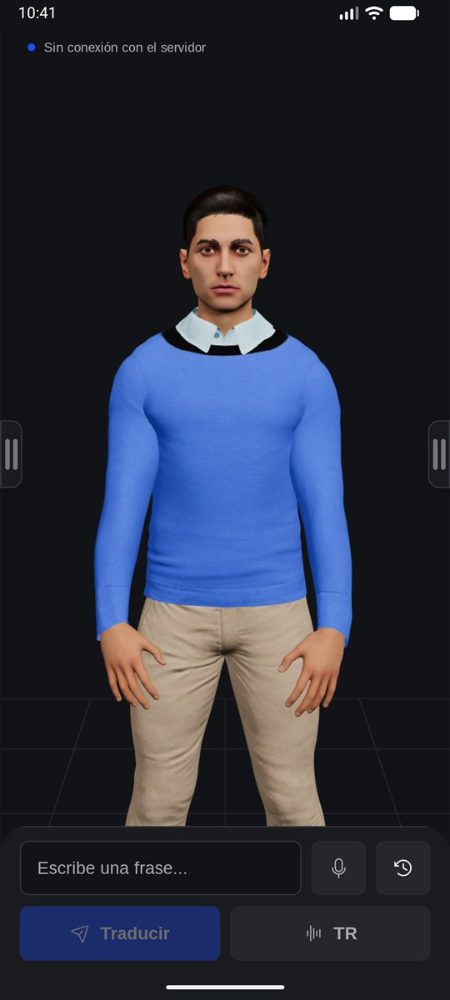 |
| 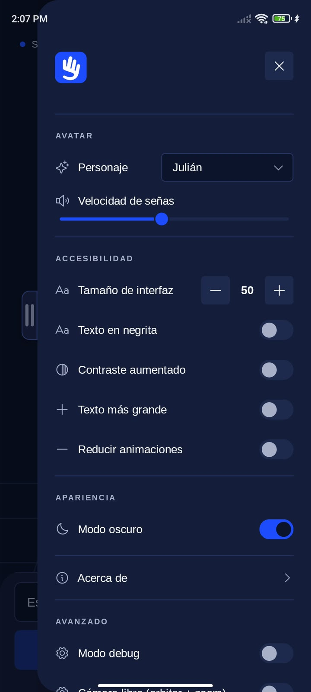 | 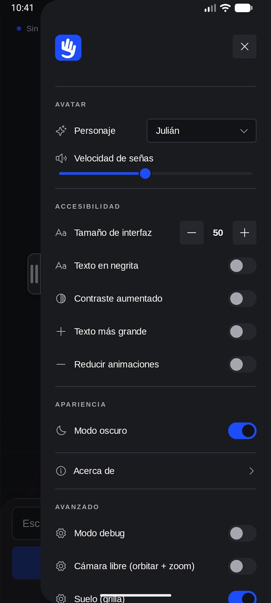 |
| 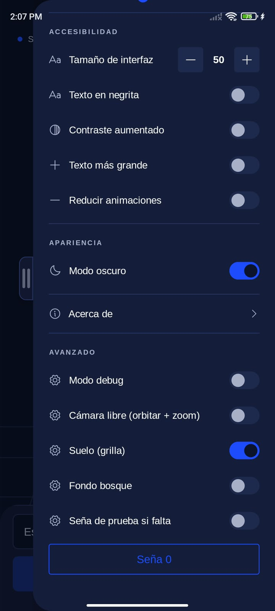 | 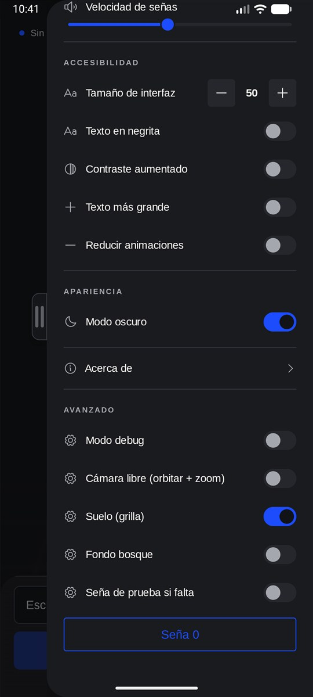 |
| 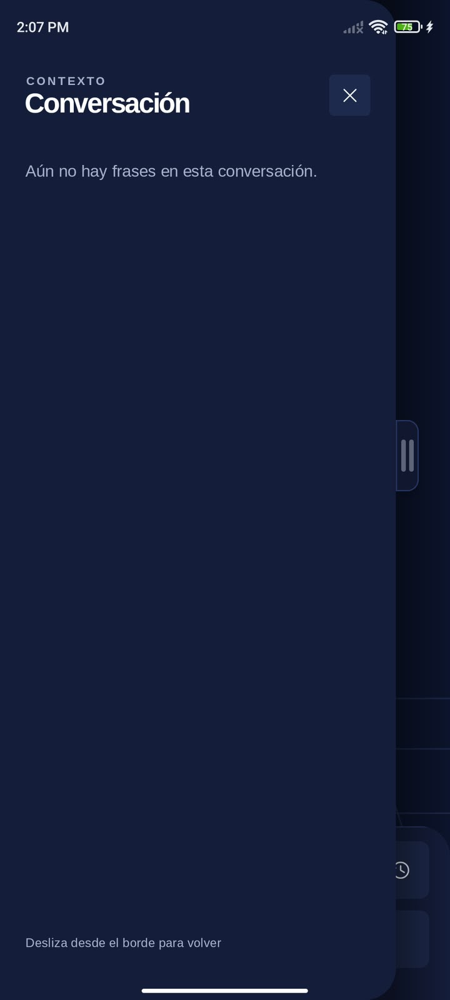 | 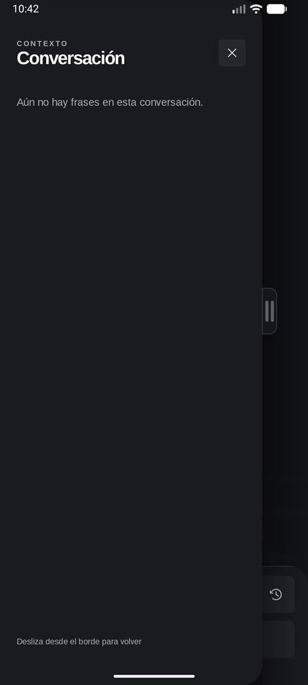 |
| 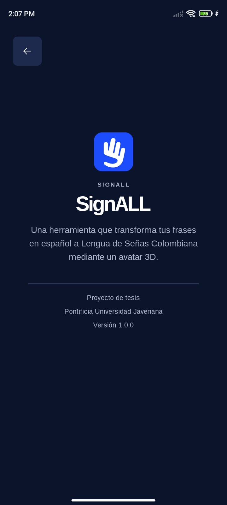 | 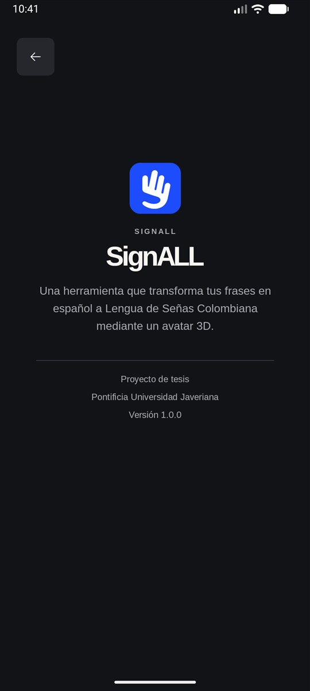 |
| 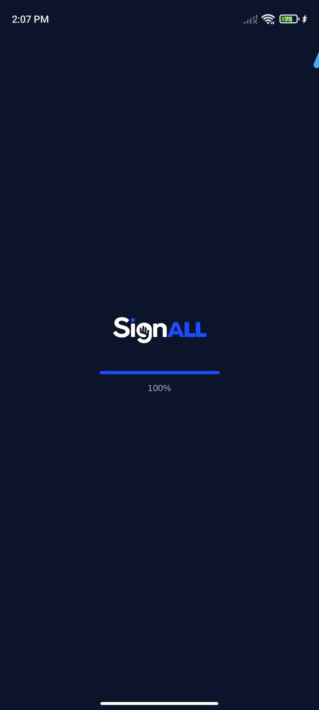 | 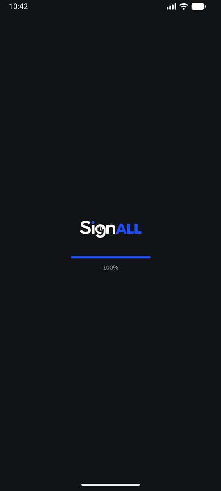 |

## Modo claro

La app también tiene modo claro (Ajustes, Apariencia). Usa la paleta clara del prototipo y el mismo azul de marca `#1C4CFC` en la acción principal, así los dos modos se sienten de la misma marca. Capturas del emulador.

| | | |
|---|---|---|
| 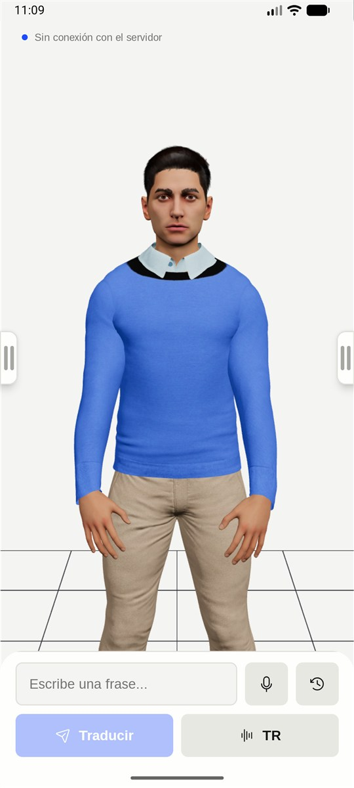 | 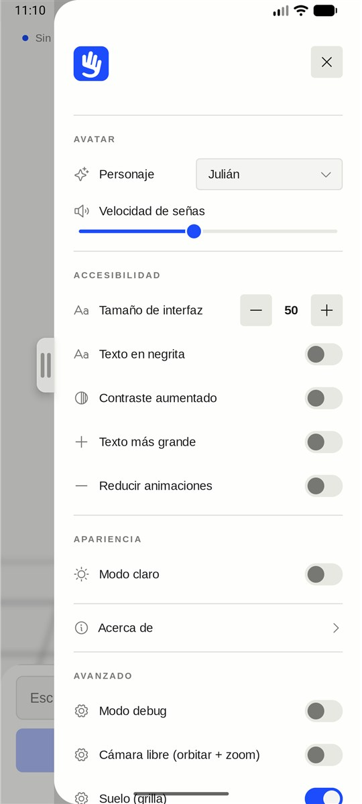 | 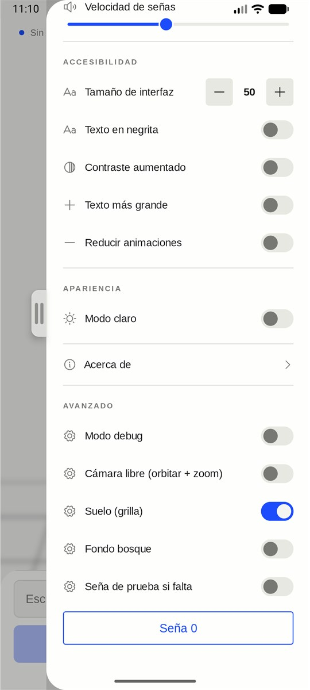 |
| 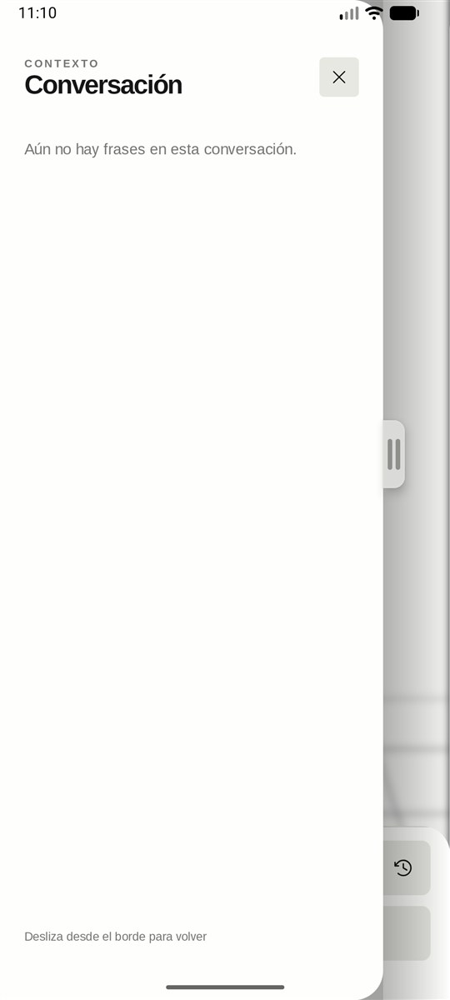 | 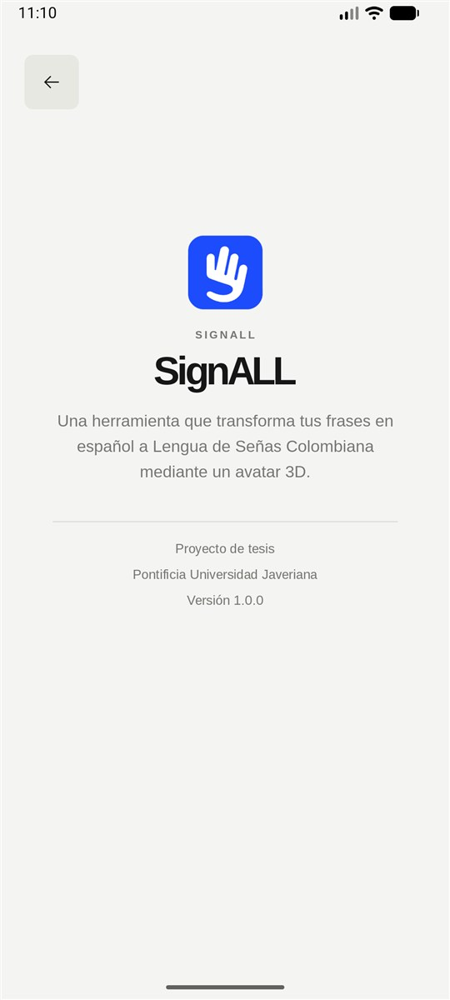 | 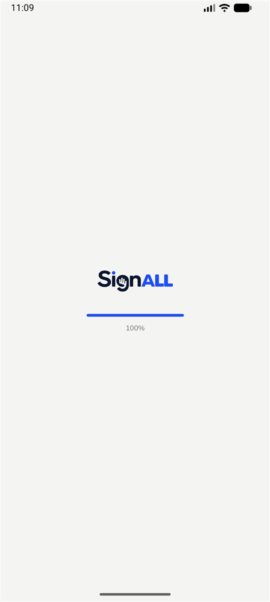 |

**Azul en claro:** Traducir, los interruptores, el slider y el punto de estado usan `#1C4CFC` (5,47:1 sobre el fondo, texto blanco encima 6,02:1). Fondo, superficies y texto no cambian. Traducir se ve azul pálido en las capturas porque está deshabilitado: no hay texto escrito.

## 2. Marca

El nombre es **SignALL**: "Sign" en tinta oscura y "ALL" en azul. La mano de la *g* es el icono de la app; la misma mano, sola dentro de un cuadrado azul, es el icono de lanzador.

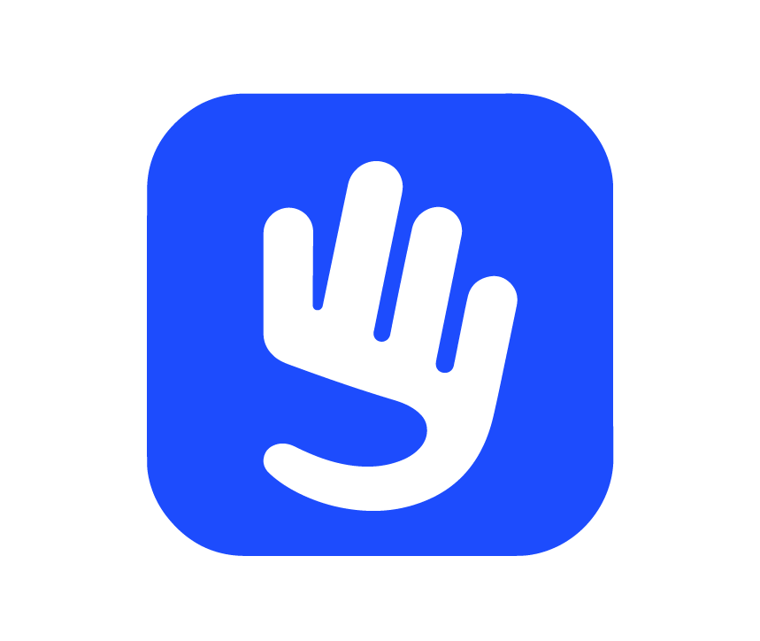

### Uso

- **Espacio libre:** deja alrededor del logotipo, como mínimo, el alto de la letra *i* en cada lado.
- **Tamaño mínimo:** logotipo de 96 px de ancho en pantalla; icono de 24 px.
- **Fondos:** el logotipo con "Sign" oscuro va solo sobre claro. Sobre grafito usa la versión con "Sign" blanco (`#F5F4F0`) y "ALL" en azul `#1C4CFC`.
- **No:** estirar o rotar el logotipo, cambiar el azul de "ALL", ponerlo en ámbar, añadir sombras o contornos, ni colocarlo sobre una foto sin una superficie lisa detrás.

## 3. Color

### Marca

| Nombre | Valor | Uso |
|---|---|---|
| Azul SignALL | `#1C4CFC` | Acción principal y controles. Texto blanco encima: 6,02:1. |
| Tinta | `#0B1730` | "Sign" del logotipo sobre claro. No se usa como fondo de la app. |
| Ámbar en vivo | `#F2B84B` | Solo cuando la app captura: micrófono y TR encendidos. Texto `#1C1503` encima: 10,13:1. |

### Modo oscuro (predeterminado de la app)

| Nombre | Valor | Contraste / nota |
|---|---|---|
| Fondo | `#121316` | |
| Superficie | `#1A1B1F` | 1,08:1 sobre el fondo |
| Suave | `#25272C` | Botones de icono y fichas. 1,24:1 |
| Borde | `#33363D` | 1,54:1 |
| Texto | `#F5F4F0` | 16,88:1 |
| Texto secundario | `#A5A7AE` | 7,73:1 sobre el fondo, 7,16:1 sobre superficie |

### Modo claro

| Nombre | Valor | Nota |
|---|---|---|
| Fondo | `#F4F4F2` | |
| Superficie | `#FEFEFC` | |
| Suave | `#E8E8E3` | |
| Borde | `#DEDED9` | |
| Texto | `#171717` | 16,28:1 |
| Texto secundario | `#777773` | |
| Acción principal | `#1C4CFC` | 5,47:1 sobre el fondo |

### Proporción

Casi toda la pantalla es neutra. El azul es un acento y el ámbar es una señal puntual: 70 % fondo, 20 % superficies, 7 % texto, 2 % azul, 1 % ámbar.

### Reglas de color

- El azul `#1C4CFC` sobre grafito da solo 2,86:1 como trazo fino. Para iconos y líneas sobre oscuro usa el texto `#F5F4F0`; el azul va como **relleno**, con texto blanco encima.
- El ámbar significa "escuchando ahora". No lo uses como decoración ni para botones que no capturan audio.
- Un control deshabilitado se marca apagando icono y etiqueta a texto secundario, no bajando la opacidad de la superficie.
- **No:** fondos o bordes con tinte azul, degradados azules ni sombras de color.

## 4. Tipografía

La app usa **Liberation Sans** (compatible en métricas con Arial), incluida en `res/font/`. El logotipo tiene su propio dibujo y no se reescribe con tipografía.

| Uso | Peso | Nota |
|---|---|---|
| Títulos de panel | Bold | Frases cortas, una línea. |
| Botones de acción | Bold | Verbo: "Traducir", no "Enviar". |
| Cuerpo y etiquetas | Regular | Mínimo 14 sp; el ajuste "Texto más grande" lo escala. |
| Texto secundario | Regular | Color `muted`, nunca por debajo de 4,5:1. |

## 5. Voz y textos

Español neutro, frases cortas, en minúscula salvo la primera letra. El botón dice lo que hace y la confirmación repite ese mismo verbo. Los errores explican qué pasó y qué hacer: "Sin conexión con el servidor. Revisa tu red y vuelve a intentar."

## 6. Accesibilidad

El texto cumple como mínimo 4,5:1 en ambos modos. La app respeta "Contraste aumentado", "Texto en negrita", "Texto más grande" y "Reducir animaciones". El ámbar nunca es la única señal: el botón también cambia de etiqueta o descripción para lectores de pantalla.

## 7. Dónde vive cada valor en el código

| Qué | Archivo |
|---|---|
| Paleta clara y oscura, tokens `strong`, `soft`, `live` | `ui/designsystem/Color.kt` |
| Fondo y suelo de la escena 3D | `assets/web/app.js` (`BG_COLOR`, `GridHelper`) e `index.html` |
| Nombre de marca | `ui/SignAiBranding.kt` |
| Tamaños, radios, espacios, movimiento | `ui/designsystem/foundation/` |

Cambiar un color se hace en `Color.kt` y se actualiza este manual en el mismo cambio. Hay una versión en PDF (`manual-identidad-visual.pdf`) para compartir.
