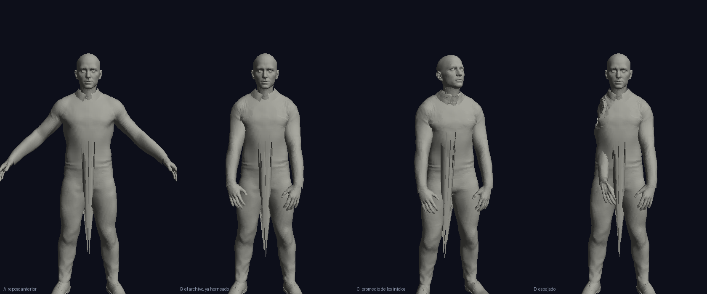
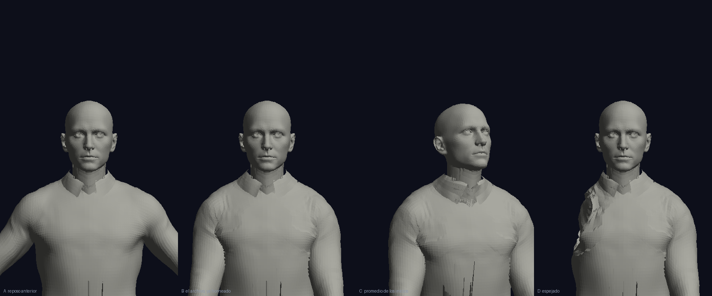

# Investigación: pose de descanso + crossfade entre señas

> Todo lo de acá está **medido**, no supuesto. Los scripts de análisis se
> escribieron en `/tmp` durante la sesión; el plan los convierte en
> `tools/` (tarea 0.1). La metodología está al final para que se pueda repetir.

Fecha: 2026-10-14 · en la rama `tiempo-real`, ya mergeada a `main` y borrada

---

## 1. La pregunta

Dos cosas que se ven mal hoy y que el owner quiere para esta sesión:

1. **Pose de descanso**: el muñeco en reposo tiene los brazos "medio abiertos",
   como de mannequin. Se quiere una posición de descanso con los brazos abajo,
   como un humano parado.
2. **Crossfade**: entre señas hay saltos. Se quiere una transición suave.

Y una pregunta de método: ¿se puede sacar la pose de descanso de los `.glb` que
ya tenemos, o hay que volver a Blender?

**Respuesta: sí se puede, y sale de un frame de una seña.**

---

## 2. Lo que hay hoy

La pose de reposo **no** es una T-pose ni un default de Three.js: es el TRS de
los nodos de `models/avatar.glb`, que es la pose de reposo que Cascadeur dejó
horneada en el export.

Medido con FK sobre el esqueleto (coordenadas del export, metros):

| | hoy |
|---|---|
| posición de las manos | `x = ±0.524`, `y = 1.092` |
| distancia al eje del cuerpo | 54 cm |
| elevación del brazo | −35° (35° bajo la horizontal) |
| codo | 30° de flexión |

Además, un detalle que conviene tener anotado porque no es obvio:

> **El TRS de los nodos de `avatar.glb` ES la pose de bind.** Verificado:
> `max |invers(IBM[k]) − mundo_del_hueso(k)| = 6e-6` sobre los 102 huesos.
> O sea que cambiar esas rotaciones **re-posea** al personaje, igual que hoy;
> no se toca la geometría (los accessors `POSITION`), así que ni el `bbox` de
> `split_signs.py` ni el `pivot` de `app.js` cambian.

---

## 3. La pose de descanso

### 3.1 Cuánto material hay

Se parsearon los 32 `.glb` de `signs/` (**2424 keyframes**, 46 variantes de clip):

| filtro | frames |
|---|---|
| los dos brazos colgando (elevación < −55°, muñecas a la altura de la cadera) | **851** (35%) |
| + "quietos" (velocidad de rotación ≈ 0, no están en mitad de un gesto) | **188** |

No hay una pose canónica compartida: la dispersión entre clips llega a 58° por
hueso. Pero sí hay un **cluster muy cerrado en los extremos**: los 46 clips
arrancan y terminan todos en el mismo lugar (desvío estándar de 2.5–6 cm). Eso
es importante para el crossfade (§4.1).

### 3.2 El frame elegido

**`signs/0029_0000_0000.glb`, variante 0, keyframe 0 (`t = 0.0417 s`)** — el
primer frame del clip de JUICIOSO.

| | reposo actual | candidato |
|---|---|---|
| mano izq / der | `x = +0.52 / −0.52` | `x = +0.215 / −0.227` |
| altura de las manos | `y = 1.09` | `y = 0.934 / 0.945` (cadera = 0.953) |
| distancia al eje | 54 cm | **32 cm** |
| elevación | −35° | **−62°** (a 28° de la vertical) |
| codo | 30° | 3–5° |
| simetría L/R | — | **1.2 cm** |
| cara | neutra | **neutra** (ningún hueso de expresión se mueve) |

Es simétrico, con las manos justo al lado de los muslos y los dedos en la
curvatura que ya tenía en la animación. Y — esto es lo importante — **es una
pose por la que el personaje ya pasó**: el skinning, la ropa y el pelo son
válidos por construcción. Un "giro de hueso a ojo" habría tenido que confiar en
que el malla no se rompe.

### 3.3 Las alternativas que se descartaron

Se evaluaron otras dos, y las dos están **descartadas con evidencia**, no con
opinión:

**C — el promedio de los 46 inicios de clip.** Está más cerca de donde arrancan
las señas (8.3 cm contra 12.9 cm del candidato) pero es asimétrico (5.5 cm entre
lados), con la cabeza girada y el brazo izquierdo más abierto.

**D — el mismo, simetrizado espejando `.L` sobre `.R`.** La idea era quedarse con
lo bueno de los dos (simétrico *y* cerca de las fronteras). **Rompe la malla:**
en el render offline aparecen costuras abiertas en el hombro y el pecho. El
motivo es que en este rig la rotación local del hueso `.R` es el espejo de la de
`.L` solo en la pose de bind (`q_R = (x, −y, −z, w)` respecto de `q_L`, regla
verificada exactamente contra los 102 huesos); promediar una pose de animación
con su espejo no cae dentro del rango para el que la malla fue tejida.

### 3.4 Verificación visual

No hay Blender ni three.js headless en la máquina, así que se escribió un
renderizador offline: LBS con las `inverseBindMatrices` del export, el mismo
`pivot` que calcula `app.js` (`escala 0.9378`, apoyo en el piso) y **la misma
cámara** que la app (`FRAME_CAMERA = [0, 1.5, 2.3]`, `FRAME_TARGET = [0, 1.1, 0]`,
fov 45°). 11 mallas, 120k vértices, ~5 s por pose.

Izquierda a derecha: **A** hoy, **B** el candidato 0029, **C** el promedio de
los 46 inicios, **D** el simetrizado (roto). B es lo pedido.

### 3.5 Lo que la pose de descanso **no** arregla

Con simulación de 10 frases reales a 60 fps (métrica: salto máximo de la mano
entre fotogramas, en cm):

| configuración | máximo |
|---|---|
| hoy (corte seco + 100 ms de reposo) | **94.5 cm/frame** (5.7 m/s) |
| solo el reposo nuevo, manteniendo el corte | 25.6 |
| solo el reposo nuevo, sin el congelado | 71.8 |

La pose de descanso sola **no alcanza**. El culpable de los saltos es otro (§4).

---

## 4. El crossfade

### 4.1 Los clips ya son continuos entre sí

Este es el hallazgo que cambia el diseño:

| | |
|---|---|
| salto directo del final de A al inicio de B | **mediana 5.9 cm**, p90 20.3 cm |
| pares que ya son continuos (< 10 cm) | **79%** |
| vuelta por el reposo de hoy | **mediana 46.6 cm** |

Los 46 clips arrancan y terminan en un cluster muy cerrado: mano izquierda en
`(+30, +91, +19) cm`, derecha en `(−13, +92, +25) cm`, con desvío estándar de
2.5–6 cm. Los exports de Cascadeur están **escritos para encadenarse**.

O sea: hoy `app.js` los desarma. `TRANSITION_FRAMES = 6` mete ~100 ms de pose
congelada de reposo **entre cada par de señas**, y con eso cada transición
paga dos saltos de ~46 cm en lugar de uno de 5.9 cm.

### 4.2 Se puede fundir sin tapar la seña

Los clips **desaceleran al terminar**: la velocidad de la mano en el último
intervalo es de 20 cm/s de mediana (contra 112–128 cm/s a 250 ms del final).

| ventana | movimiento al final del clip | al inicio del siguiente |
|---|---|---|
| 42 ms | 0.8 cm | 0.9 cm |
| 83 ms | 3.3 cm | 3.0 cm |
| 125 ms | 7.1 cm | 5.7 cm |
| 167 ms | 12.3 cm | 8.6 cm |

Con una fundición de **100 ms** se está fundiendo casi exclusivamente pose ya
asentada: ~3 cm de movimiento real de cada lado.

### 4.3 Three.js lo resuelve solo

`three@0.169.0` (el que usa `index.html`) tiene `crossFadeTo`, `fadeIn`,
`fadeOut`. Revisando el source:

- `PropertyMixer.apply()`: cuando el peso acumulado es `< 1`, completa con
  `(1 - weight)` del valor **guardado cuando se creó el binding**
  (`saveOriginalState`, `three.module.js:49034`). Ese valor es el TRS del nodo,
  o sea **la pose de descanso nueva**. Por eso `fadeOut()` vuelve al reposo
  exactamente, sin escribir un solo keyframe a mano.
- `_scheduleFading()` usa `mixer.time` como reloj, y `app.js` ya llama
  `mixer.update(dt * speed)`: la fundición sigue sola al factor de adelanto
  automático, sin código extra.

### 4.4 Cuánto dura la fundición: medido, no a ojo

Simulación de 10 frases reales a 60 fps, mismo criterio:

| configuración | máximo (cm/frame) |
|---|---|
| hoy | 94.5 |
| reposo nuevo, corte seco | 71.8 |
| crossfade 50 ms | 24.0 |
| crossfade 75 ms | 16.0 |
| **crossfade 100 ms** | **12.1** |
| crossfade 125 ms | 9.7 |
| crossfade 150 ms | 8.8 |
| crossfade 200 ms | 8.8 |

El piso de 8.8 cm/frame es la velocidad real de una seña rápida, no un salto: a
partir de 150 ms no se mejora nada.

**Recomendación: 100 ms.** Se elimina el 87% del salto (94.5 → 12.1) solapando
solo ~3 cm de gesto de cada lado. 150 ms si se
prioriza la máxima suavidad sobre la claridad de la seña. Es una constante, se
cambia en una línea.

### 4.5 Sale más corto, no más largo

El clip siguiente arranca 100 ms antes del final del anterior, así que cada
transición *ahorra* tiempo en vez de gastarlo:

| frase | hoy | con crossfade 100 ms |
|---|---|---|
| HOLA + BUENOS DIAS + COMO ESTAS | 6.72 s | **6.12 s** |
| BIEN + GRACIAS + TRISTE | 8.01 s | **7.41 s** |
| HOLA + GRACIAS + BIEN + TRISTE + CONTENTO | 12.50 s | **11.50 s** |

Promedio **8% menos** de animación por turno. Es decir que `rt_turn_total_ms`
debería mejorar, no empeorar, y el adelanto automático va a dispararse menos.

---

## 5. Lo que hay que decidir antes de escribir código

| # | decisión | propuesta |
|---|---|---|
| D1 | duración de la fundición | 100 ms (constante `CROSSFADE_FRAMES`) |
| D2 | el clip siguiente tiene que estar cargado antes de la frontera | precargar al arrancar el clip actual; si no llega, corte seco |
| D3 | cuándo se dispara `onPlaybackDone` | al terminar la fundición de salida, que ya está calendarizada para acabar con el clip → sin latencia agregada |
| D4 | `playFrom` (Repetir) en mitad de una fundición | matar la action que sale antes de arrancar la nueva |
| D5 | long press (reset) | corte seco: es un gesto de "reset", no una transición |
| D6 | `reduceMotion` | hoy no se le pasa a la WebView. Decidir si la fundición se desactiva |
| D7 | métricas | `rt_turn_total_ms` mejora ~8%; hay que remedir y actualizar la línea base documentada (p50 913 ms / p95 1336 ms) |

---

## 6. Metodología (para repetir)

Todo sale de parsear los `.glb` a mano (`tools/split_signs.py` ya tiene
`read_glb`/`write_glb`), sin dependencias:

1. **FK**: composing `T·R·S` por el árbol de nodos. Ojo con dos trampas que
   costaron tiempo:
   - los `accessors` enteros (`JOINTS_0`) hay que leerlos como `uint16`, no
     como `float32`;
   - las `MAT4` (`inverseBindMatrices`) son **column-major**: hay que
     transponerlas. Sin eso la malla explota.
   - y al interpolar una animación hay que reemplazar los tres canales por
     nodo (T, R y S), no solo la rotación: un `chans[nodo] = ...` se queda con
     el último.
2. **Interpolación**: `LINEAR` sobre `slerp` implícito de three.js es
   suficientemente distinto a los efectos observados (ángulos de ≤58°) como para
   que las cifras no cambien; para las medidas finas (cm) seDvuelve a muestrear
   los keyframes.
3. **Puntos de comparación**: se usa la posición de las manos
   (`hand.L` / `hand.R`), que es lo que el ojo sigue, no ángulos de hueso.
4. **Simulación de cola**: se precalculan las manos de los 46 clips a 60 fps y
   se reproduce la línea de tiempo mezclando poses por peso. La mezcla real de
   three.js interpola *quaterniones locales*, no posiciones; para medir saltos
   de 5–90 cm la diferencia es de segundo orden.

Scripts de la sesión (a promover a `tools/` en la tarea 0.1):

| script | qué hace |
|---|---|
| `lib.py` | lectura de GLB, FK, sampling de clips |
| `scan.py` / `best.py` | ranking de frames por brazos abajo + quietud + simetría |
| `canon2.py` | cluster de los 46 inicios y simetrizado espejado |
| `boundaries.py` / `window.py` | saltos entre señas y tamaño de la ventana de fundición |
| `render.py` | renderizador offline (LBS + pivot + cámara de la app) |
| `sim.py` | simulación de cola y barrido de duración de fundición |